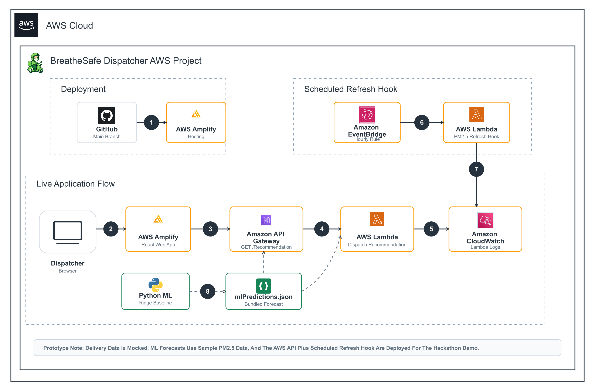

# BreatheSafe Dispatcher

<p align="center">
  
</p>

<p align="center">
  <span style="color:#6b7280">Reducing delivery rider PM2.5 exposure without slowing the city down.</span>
</p>

## Problem And Solution

Delhi/NCR delivery riders spend long shifts outdoors during severe PM2.5 windows. Fastest dispatch can send riders through more polluted roads or assign orders from a nearby store even when a cleaner store or route would add only a small delay.

BreatheSafe Dispatcher is a pollution-aware dispatch assistant for delivery platforms. It compares delivery options, recommends a lower-exposure store and route, keeps the customer promise visible, and sends simple rider safety prompts such as mask use, cleaner route selection, and nearby rest-zone guidance.

## Demo

**Live App:** [main.d224px9v4j740t.amplifyapp.com](https://main.d224px9v4j740t.amplifyapp.com/)

**Demo Video:**

[](https://www.youtube.com/watch?v=YOUTUBE_VIDEO_ID)

## Architecture



BreatheSafe is deployed as a React web app on AWS Amplify. The dispatch recommendation is served by AWS Lambda through Amazon API Gateway. Amazon EventBridge triggers a scheduled refresh hook for the PM2.5 risk window, and Amazon CloudWatch captures backend logs.

## Features

- Dispatcher view with fastest, cleaner, and recommended delivery options.
- Delhi/NCR map showing route choices and PM2.5 risk points.
- Consumer app preview explaining whether pollution-aware dispatch added delay.
- Rider safety prompts for masks, cleaner routes, and rest zones.
- Metrics page showing exposure reduction, delay added, SLA impact, and risky distance avoided.
- PM2.5 baseline model using scikit-learn Ridge regression on sample Delhi/NCR pollution data.
- AWS-hosted frontend plus serverless API for the recommendation flow.

## How It Works

The app starts with one live demo order during a severe PM2.5 window. It compares available dispatch choices by delivery time, rider exposure score, polluted road distance, and SLA status. The recommended choice is the one that reduces rider exposure while keeping the delivery promise reasonable.

The ML baseline forecasts PM2.5 for Delhi/NCR areas using current PM2.5, time, weather-like context, traffic, demand, construction, and inversion-risk features. The model is intentionally small and explainable for a hackathon demo.

Current validation result:

- Ridge RMSE: `2.28`
- Same-as-now baseline RMSE: `12.12`
- Improvement vs baseline: `81.2%`

## AWS Services Used

- **AWS Amplify:** Hosts the React frontend from GitHub.
- **AWS Lambda:** Runs the dispatch recommendation endpoint and PM2.5 refresh hook.
- **Amazon API Gateway:** Exposes `GET /recommendation` to the frontend.
- **Amazon EventBridge:** Schedules periodic PM2.5 refresh logic.
- **Amazon CloudWatch:** Stores Lambda execution logs.

Deployed backend:

```text
Region: ap-southeast-2
Stack: breathesafe-dispatcher-api
API: https://f1tivjhtne.execute-api.ap-southeast-2.amazonaws.com/recommendation
```

## Tech Stack

- React
- TypeScript
- Vite
- Leaflet and OpenStreetMap
- Recharts
- Python
- scikit-learn
- AWS Amplify, Lambda, API Gateway, EventBridge, and CloudWatch

## Run Locally

Install dependencies:

```bash
npm install
```

Start the web app:

```bash
npm run dev
```

Train the PM2.5 baseline model:

```bash
pip install -r requirements.txt
npm run ml:train
```

Build for production:

```bash
npm run build
```

## Backend Configuration

The frontend can work with local fallback data as well. To use the deployed AWS API, set:

```text
VITE_RECOMMENDATION_API_URL=https://f1tivjhtne.execute-api.ap-southeast-2.amazonaws.com/recommendation
```

## Assumptions / Mock Data

This is a hackathon prototype. Delivery data is mocked, and PM2.5 data is sample Delhi/NCR data used to demonstrate the decision flow. A production version would connect live pollution feeds, real store availability, route APIs, and platform dispatch systems.

